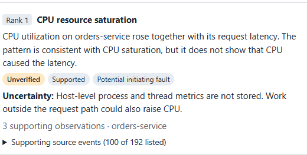

# AEGIS AI

I built AEGIS AI to understand what happens after several alerts fire
at once. Which alerts belong to the same incident? What does the
evidence show, and what should I check next?

The backend generates synthetic service metrics, compares them with
normal baselines, and groups related alerts into incidents. I built
a React dashboard to browse those incidents and see the evidence,
possible causes, and suggested checks.

## Try the demo

Start with the CPU saturation case. The dashboard shows how alerts
from the API gateway and orders service were grouped. CPU saturation
ranks first as a possible explanation, and the report shows what
evidence is still missing. I kept the **Unverified** label visible
so readers can see that the cause is still open.

Follow the [local demo guide](docs/demo.md) to start FastAPI, load
the synthetic data, and open the dashboard. The dashboard runs
without an API key. To run the same demo in containers, use the
[Docker Compose section](docs/demo.md#docker-compose-demo).

## The investigation agent

I also built a separate Claude agent that can request approved
read-only tools. Python checks the agent's selections against the
incident evidence before accepting the report. I tested that
workflow end to end on one synthetic incident.

- [Portfolio walkthrough](docs/portfolio-walkthrough.md): the dashboard, the
  Docker demo, the architecture, and the two investigation paths
- [Architecture and design decisions](docs/architecture.md)
- [Offline evaluation walkthrough](docs/offline-evaluation-demo.md)

**Stack:** Python, FastAPI, Pydantic, React, TypeScript, and Vite.
